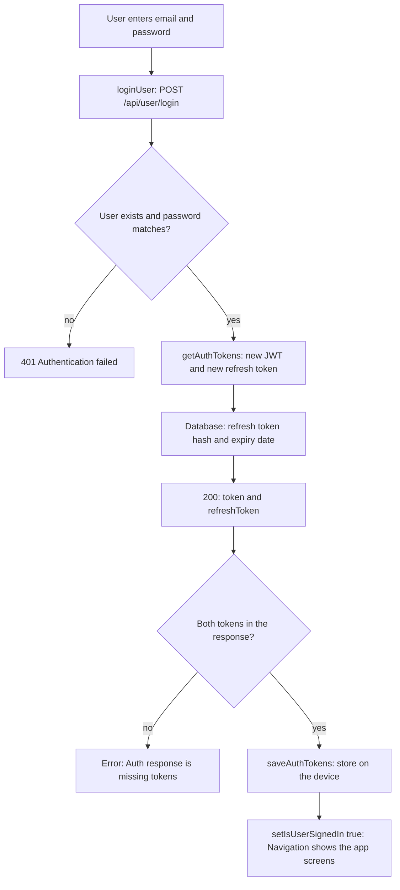
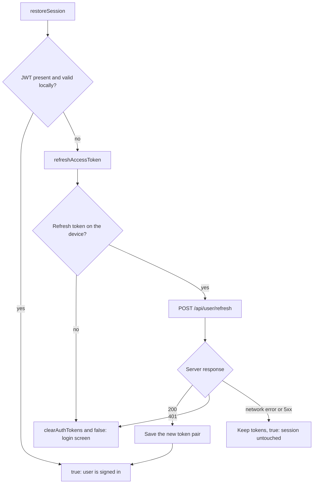
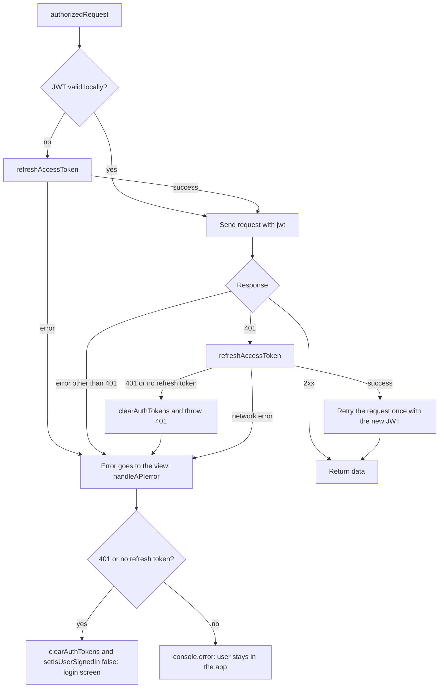
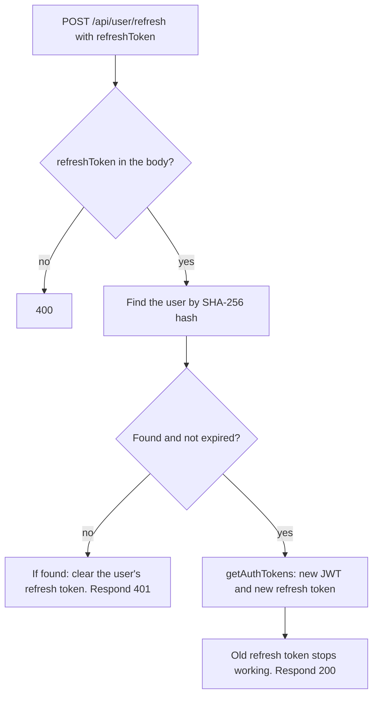

# Authentication flow

How the app logs a user in, restores the session on start, refreshes tokens during requests, and logs the user out when the session cannot be saved.

## Tokens

| Token | Details |
| --- | --- |
| Access token | JWT valid for 1 hour (`JWT_ACCESS_EXPIRES`). Sent with API requests as the `?jwt=` query parameter. |
| Refresh token | 32 random bytes, valid for 30 days (`REFRESH_TOKEN_DAYS`). Only its SHA-256 hash is stored in the database. Every refresh issues a new one and invalidates the old one. |
| Storage | AsyncStorage on mobile (`@jwt`, `@refreshToken`), cookies on web (`jwt`, `refreshToken`). |

The server keeps a single refresh token per user, so logging in on a second device invalidates the session on the first.

## 1. Password login

The only place where the user enters a password. The result is a token pair saved on the device.

Files: `client/src/views/LoginView/LoginView.js`, `client/src/js/api.js` (`loginUser`), `server/src/resources/user/user.router.js` (`/login`), `server/src/utils/tokens.js`.

## 2. App start and screen focus

The `validateJWTFronted` hook and `Navigation` call `restoreSession`. Its result goes to Redux and decides whether the user sees the app or the login screen.

Files: `client/src/js/api.js` (`restoreSession`), `client/src/Navigation.js`, `client/src/hooks/validateJWTFrontend.js`.

Tokens are cleared only on an explicit 401 or when there is no refresh token. A network failure does not log the user out.

## 3. API request (expenses)

Every API request (list, month, add, delete) goes through `authorizedRequest`. It retries exactly once, and only after a 401.

Files: `client/src/js/api.js` (`authorizedRequest`, `handleAPIerror`), `ExpensesView`, `AddExpenseView`, `ExpensesListItem`.

Logout happens in one place, `handleAPIerror`, when the error is a 401 or the refresh token is missing. Network and server errors are only logged to the console.

## 4. Refresh on the server

The `/refresh` endpoint takes the refresh token in the request body, not in the URL.

Files: `server/src/resources/user/user.router.js` (`/refresh`), `server/src/utils/tokens.js`.

Tokens rotate: if a 200 response is lost on the way, the client keeps the old, already invalid token and has to log in again.
